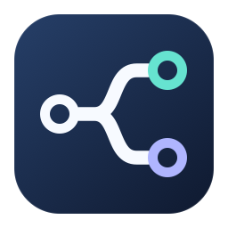

# Link Router

A native macOS menu bar app that sends links from Slack to Island and other web links to Google Chrome.



## Build and install

Requires macOS 13 or later and Apple's Command Line Tools. No third-party dependencies.

```sh
bash build.sh
bash install.sh
```

The build runs the routing checks and creates an ad-hoc signed `build/Link Router.app` for the current Mac's architecture. The installer updates `~/Applications/Link Router.app`, migrates the previous Slack Link Router installation, and enables Start at Login. Previous app bundles are retained in a temporary backup folder.

For a first installation, choose **Link Router** in **System Settings → Desktop & Dock → Default web browser**. The menu bar status confirms whether routing is enabled. During upgrades, the installer reads and preserves the existing installation's bundle identifier in the installed copy, so its browser and login preferences survive. The source and public build artifacts retain the generic identifier `local.linkrouter.app`.

## Startup and settings

Link Router starts automatically when you sign in to macOS. The **Start at Login** menu item can turn this on or off using the native macOS login-item service. If macOS requests approval, allow Link Router in **System Settings → General → Login Items & Extensions**.

To stop routing, select **Switch Back to Chrome…**, then choose **Google Chrome** as the default browser in System Settings. Change the default and turn off Start at Login before deleting the app.

## Logo

The logo shows one connection splitting into two destinations: teal and lavender rings on a dark blue tile. A monochrome version appears in the menu bar and adapts to light and dark appearance.

Run `bash generate-icons.sh` to regenerate the PNG, ICNS, and PDF assets from the native vector renderer.

- `Assets/link-router.svg` — editable application logo.
- `Assets/mark.svg` — standalone monochrome mark; uses `currentColor`.
- `Assets/link-router.png` — 1024 px raster export.
- `Assets/AppIcon.icns` — complete macOS icon sizes.
- `Assets/MenuBarIcon.pdf` — vector menu bar icon.
- `Tools/GenerateIcon.swift` — reproducible native renderer and icon generator.

## Routing behavior

- Uses the originating process from the URL's Apple event. Slack and its helpers route to Island (`io.island.Island`). Other and unidentified sources route to Chrome (`com.google.Chrome`).
- Forwards the original URL through macOS APIs, preserving escaping, query parameters, and fragments.
- Shows an error if the selected browser is unavailable. Slack links are not silently sent to another browser.
- HTML and XHTML documents handed to the app open in Chrome.
- Navigation inside a browser stays there. Apps that explicitly select a browser or use universal links can bypass the system handler.
- No account, network service, Accessibility permission, Automation permission, telemetry, or persistent URL history.

## Verification and diagnostics

`bash build.sh` runs the routing checks. To exercise real macOS source-app attribution without opening a web page, run `bash prepare-integration.sh` and `python3 Tests/integration.py` with the installed app quit. The integration test launches a separate diagnostic instance.

`--diagnostic` prints source and destination identifiers without opening a browser. `--trace-routing` prints the same identifiers while forwarding links normally. Neither mode records URLs. Quit and reopen the app normally to disable tracing.

`build/app-control` displays the current HTTP/HTTPS handlers and router process.

## Publishing

The source uses generic app identifiers. Generated app bundles and build caches belong in the ignored `build/` directory. The menu bar PDF is generated without author, machine, or timestamp metadata. The PNG assets contain only image dimensions and color information.
